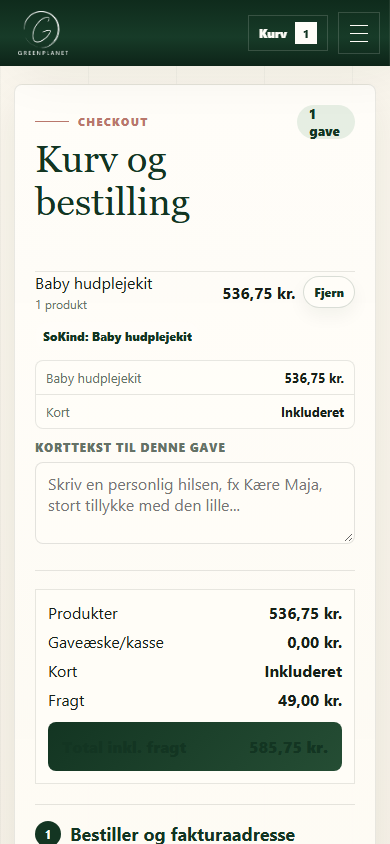
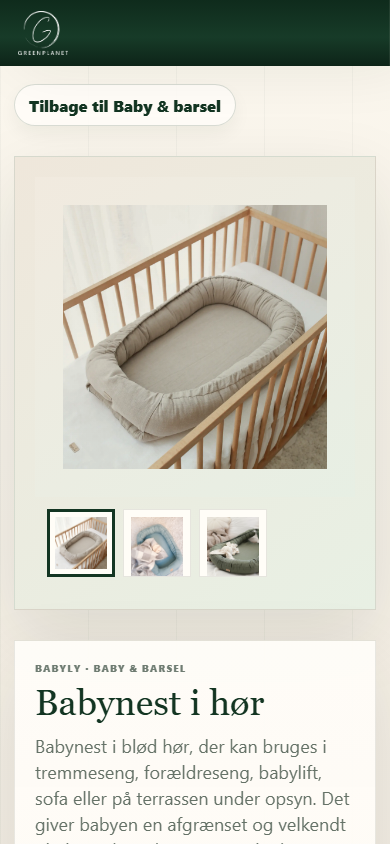
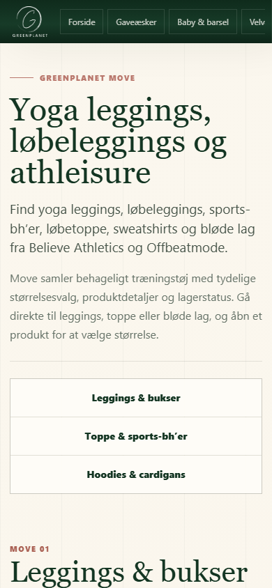
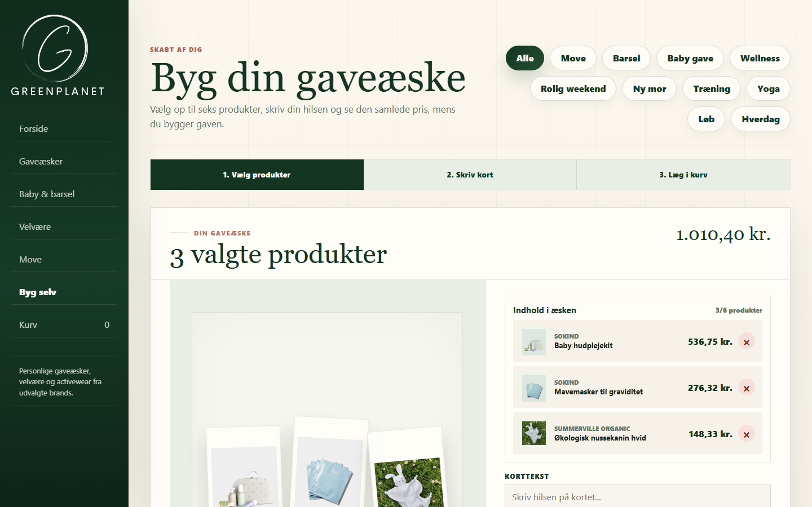
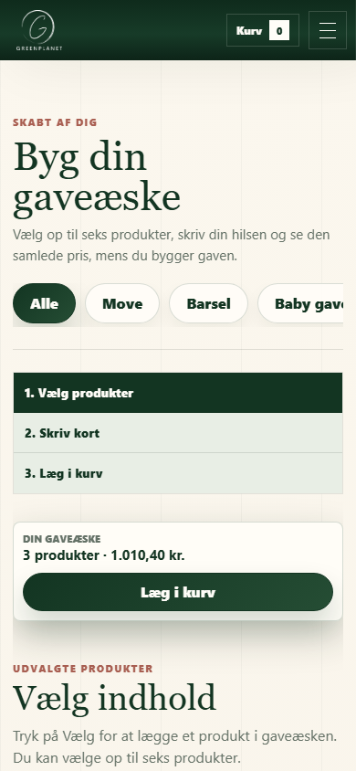

# Greenplanet: design- og brugervenlighedsplan til Sol Høj

Dato: 21. november 2026. Status: første leverance implementeret lokalt; de resterende punkter er stadig en plan. Live-status kræver særskilt verifikation efter deployment.

## Status for første leverance

- D01: kontrast på kurvens totalrække rettet lokalt.
- D02: fælles menu/kurv på kategori- og detaljesider samt footer på disse sider. Forsidens eksisterende menu og footer er endnu ikke flyttet til de fælles komponenter.
- D03: miniaturebilleder klikbare; variantbillede og variantpris koblet til købspanelet lokalt.
- D05: kategori-intro komprimeret, og den uddybende tekst flyttet under udvalget. Egentlige Move-filtre er endnu ikke lavet.
- D04: produktlisten vises før den store æskeillustration på desktop, og de dekorative trin er fjernet. Mobilens første produktfoto vises nu i første viewport. En fuld mobil "Se din æske"-interaktion er endnu ikke lavet.
- D06, D07 og D08 er ikke implementeret.

## Formål og rammer

Gør Greenplanet mere indbydende og lettere at handle på med de nuværende farver, logo og varer. Første prioritet er synlig kurv, læselige priser, fungerende produktbilleder og en kortere vej til at vælge produkter. En ny farvepalette eller flere dekorative sektioner er ikke opgaven.

- Bevar Greenplanets logo uden beskæring, den eksisterende grønne farve, lyse flader og koralfarvede accenter.
- Bevar forsideteksten: "Barsels- og babygaver i flotte gaveæsker".
- Hold firmagaver skjult, indtil et relevant udvalg er godkendt. Brug aldrig babyprodukter som erstatning.
- Vis ikke antal varer som salgsargument i kategorier. Kurvantal og antal valgte produkter i byg-selv er fortsat relevante.
- Ændr ikke priser, lagerregler, juridiske vilkår, samtykke, Stripe-indstillinger eller leverandøraftaler.
- Brug dansk med æ, ø og å. Ingen omtale af Faire eller interne udviklingsplaner i kundernes interface.
- Bevar kurvens `source`, variant-ID'er, korttekst, fragtberegning og redigering af gaveæsker.
- Bevar request-time katalogindlæsning, metadata, canonical-links, sitemap og strukturerede data. Flyt ikke hele kategorisider til client-only rendering.

## Kontrolleret grundlag

Livekontrol på `https://www.greenplanet.dk` i isoleret Chromium ved 390 × 844 og 1440 × 900. Forside, Move, gaveæsker, babynest, gaveæskedetalje, byg-selv og kurv blev undersøgt. Koden blev sammenholdt med commit `de7265e` på `cloudflare-migration-2026-11-07`.

Kontrollen oprettede kun en lokal testkurv. Ikke-GET-kald til `/api/**` blev blokeret i testbrowseren. Ingen betaling, kundeoprettelse eller mail blev sendt. Derfor er dette ikke en verifikation af hele betalingsflowet. Analytics og Search Console er ikke aflæst i denne designgennemgang; prioriteringen bygger på observerbare problemer, ikke på påståede konverteringstal.

| Observeret på live | Betydning |
| --- | --- |
| Kurvens totaltekst er `rgb(19, 53, 34)` på en gradient, der starter med samme farve | Totalbeløbet er næsten ulæseligt |
| Mobilforsiden har menu og kurv; kategorier har vandret linkrække; babynest har kun logo i headeren | Navigationen ændrer sig under købet, og kurven er ikke altid synlig |
| Klik på babynests andet miniaturebillede ændrer ikke hovedbilledet | Galleriet ligner en funktion, som ikke virker; thumbnails er `span` uden klikfunktion |
| Valg af Havblå viser et ekstra variantbillede, men hovedgalleriet bliver på første billede | Kunden ser to forskellige produktfarver samtidig |
| Første Move-produktrække starter ved y=893 på mobil og y=888 på desktop | Første skærm viser næsten kun tekst og navigation |
| Første byg-selv-produktrække starter ved y=897 på mobil og y=1520 på desktop | Man skal forbi introduktion og opsummering, før man kan vælge noget |
| Første gaveæskerække starter ved y=674 på mobil og y=697 på desktop | To introducerende overskrifter skubber selve udvalget ned |
| Kategori- og produktsiderne har ingen fælles footer | Kontakt og praktisk information er ikke tilgængelig samme sted på tværs af shoppen |
| Mobilkurven gentager produktnavn/pris flere steder og viser endnu en ordreoversigt efter betalingsknappen | Overblikket bliver langt uden tilsvarende ekstra information |

Y-positioner er øjebliksbilleder ved de nævnte skærmstørrelser, ikke generelle performance-målinger. De første tre Move-billeder blev kontrolleret efter scroll og var indlæst. Blanke områder i en fuldskærmsoptagelse af lazy-loaded indhold er ikke dokumentation for defekte billeder.

## Implementeringsrækkefølge

### D01 · P1 · Gør alle købsbeløb læselige

**Problem:** Den grønne totalbjælke i kurven har mørkegrøn tekst på mørkegrøn baggrund. Det er en konkret fejl, ikke en smagssag.

**Udfør:** Sæt eksplicit lys tekst på totalrækken og dens børn. Brug den eksisterende lyse farve. Kontrollér også totaler i byg-selv, gaveæskedetaljer og ordreoversigten samt primære knappers normal-, hover-, fokus-, loading- og disabled-tilstande. Ret det relevante scope; undgå en global regel, der gør al `strong`-tekst lys.

**Filer:** `app/premium.css:195`, `app/styles.css:272`, `app/page.tsx:1747`.

**Godkendelse:** Normal tekst i aktive totalrækker/knapper har mindst 4,5:1 kontrast. Beløb og labels er læselige ved begge ender af gradienten. Ingen afskæring ved 360 px bredde eller 200 % zoom. Beløbene er uændrede.

### D02 · P1 · Én navigation og footer gennem hele shoppen

**Problem:** Mobilnavigationen har tre forskellige udformninger. På babynests produktside er menu og kurv væk. Kategoriernes kurv ligger uden for den synlige del af linkrækken.

**Udfør:** Udtræk en fælles offentlig navigation med en lille klientdel til kurvtæller og mobilmenu. Bevar desktopsidebaren. Mobilheaderen skal altid indeholde hele logoet, et kurv-ikon med antal og en menuknap. Brug en kendt ikonkomponent fra projektets bibliotek. Menuknappen åbner en overskuelig menu med aktiv side, konto og eksisterende kundelinks. Tilføj den eksisterende footer på kategori-, produkt- og gaveæskedetaljesider uden at ændre juridiske tekster.

**Filer:** `app/page.tsx:1145`, `app/_components/StoreCategoryPage.tsx:15`, `app/products/[id]/page.tsx:250`, `app/giftboxes/[id]/page.tsx`, `app/premium.css:319` og `:621`. Fælles komponenter kan ligge i `app/_components/`.

**Godkendelse:** Header ca. 60-68 px høj på mobil, sticky uden at dække indhold. Kurven kan åbnes fra alle nævnte sider og viser korrekt antal efter navigation og reload. Menuen virker med tastatur, Escape og touch; fokus flyttes ind og tilbage, og skjulte links kan ikke få fokus. Scroll-position og browserens tilbageknap virker. Footerens kontakt-, leverings-, retur- og kontolinks virker på alle sidetyper.

### D03 · P1 · Et rigtigt produktgalleri, koblet til variantvalget

**Problem:** Miniaturebilleder er ikke klikbare. Farvevalget styrer et separat billede i købsfeltet i stedet for hovedbilledet. Hovedprisen er desuden serverrenderet uden forbindelse til den valgte variant; den skal vise variantprisen, når priser faktisk varierer.

**Udfør:** Genbrug mønstret fra den interaktive `ProductGallery` i `app/page.tsx:328` i en fælles klientkomponent. Giv købspanelet og galleriet én lokal varianttilstand, men behold produkttekst og SEO serverrenderet. Thumbnails bliver knapper med et tilgængeligt navn, valgt tilstand og fokusmarkering. Farvevalg vælger variantens rigtige billede. Størrelsesvalg må ikke skifte farve. Tilføj et enkelt zoom-dialogvindue med luk-knap og Escape; ingen ekstra galleribibliotek medmindre projektet allerede har et passende.

**Filer:** `app/products/[id]/page.tsx:272`, `app/products/[id]/AddToCartButton.tsx`, `app/page.tsx:328`, gallery- og variantregler i `app/styles.css` og `app/premium.css`.

**Godkendelse:** På `/products/p2` skifter thumbnail 2 hovedbilledet; Havblå viser det havblå produkt i hovedgalleriet. Valgt farve/størrelse, hovedpris og kurvlinje stemmer overens. Udsolgte varianter kan ikke købes. Test forskellig variantpris med en lokal fixture, ikke ved at ændre livepriser. Billedernes felt beholder samme størrelse under skift; intet layout-hop. Dialogen kan lukkes med tastatur og touch.

### D04 · P2 · Byg-selv: produkterne først, indholdet ved siden af

**Problem:** Desktop starter med en stor æskeillustration og opsummering, så produkterne ligger over en hel skærm længere nede. Mobil starter med intro, filtre, tre ikke-klikbare trin og en totalboks før varerne.

**Udfør:** På desktop placeres produktlisten til venstre og en kompakt indholdsoversigt til højre. Højst tre produktkort på en række; brug to, hvis den resterende bredde gør tre for smalle. Reducér æskeillustrationen til et valgfrit mindre preview med faktiske valgte produktfotos. På mobil kommer kort intro, kategorivalg og produkter først. Vis en kompakt bundlinje med antal og pris samt "Se din æske", som åbner indhold, variantvalg, korttekst og afsluttende kurvknap. Gør trinindikatoren kompakt eller fjern den; den skal ikke ligne knapper, hvis den kun viser status.

**Filer:** Byg-selv-blokken i `app/page.tsx:1532`, `app/premium.css:898` og mobilregler `:1069-1126`, relevante `.builder-*` i `app/styles.css`.

**Godkendelse:** Første produktfoto starter senest ca. 450 px fra dokumenttop på mobil og 400 px på desktop ved de aftalte viewports. Produktvalg viser foto, navn, variant og pris tydeligt; fjernelse, grænse på seks, tom æske, udsolgt variant, korttekst og redigering af eksisterende kurvlinje testes. Bundlinjen må ikke dække sidste produkt, cookie-dialog, tastatur eller formularfelter. Gaveæske/kort og fragt er stadig tydeligt specificeret ved køb.

### D05 · P2 · Kortere kategorier og reel filtrering i Move

**Problem:** Store H1'er, to forklarende afsnit og endnu en stor sektionsoverskrift kommer før udvalget. Move-kategorier hopper kun ned på en meget lang side; de afgrænser ikke udvalget.

**Udfør:** Brug én kompakt kategorioverskrift og ét relevant introafsnit. Fjern UI-forklaringer som "tydelige størrelsesvalg, produktdetaljer og lagerstatus" fra salgsteksten. Bevar relevant guide-/SEO-tekst længere nede. Tilføj et kategorifilter med Alle, Leggings & bukser, Toppe & sports-bh'er og Hoodies & cardigans. Synkronisér med query-parametre, så valg overlever tilbage-navigation; canonical forbliver kategorisiden. Filtrér på eksisterende kategoriinddeling, uden at ændre produktdata. Flyt ikke eksisterende indeksérbart katalog til en klient-fetch.

**Filer:** `app/_components/StoreCategoryPage.tsx:105`, `app/move/page.tsx`, `app/gaveaesker/page.tsx:68`, `app/premium.css:267-353`.

**Godkendelse:** Første produktfoto starter senest ca. 450 px på mobil og 500 px på desktop. Cardigans kan findes direkte uden scroll gennem alle leggings. Aktivt filter er tydeligt og har en tilgængelig label; tomt resultat kan nulstilles. Ingen antal-badges i kategorinavigationen. Ingen ændring af indekserbare produktlinks eller skjulte firmagaver.

### D06 · P2 · En forside, der viser varer tidligere

**Problem:** På 390 px starter forsidens H1 ved y=619 efter et stort billede. På desktop konkurrerer flere handlingsknapper og slider-overlay om opmærksomheden. Siden går derefter primært over i kategorilinks og lange tekster frem for konkrete købsmuligheder.

**Udfør:** Saml foto, den eksisterende H1 og en primær "Se gaveæsker"-handling i én bred hero med tekst direkte over billedet, ikke et split-layout med et separat tekstkort. Brug et godkendt foto, hvor den faktiske vare stadig er tydelig; vælg en komposition med plads til teksten. En diskret sekundær "Byg din egen" kan bevares. Behold slider kun hvis hvert slide har et klart formål, pausekontrol og reduced-motion-adfærd. Vis derefter reelle gaveæsker med pris og indhold samt en separat billedbåret Move-sektion. Brug eksisterende katalogdata; ingen fiktive bestsellere eller anmeldelser.

**Filer:** `app/page.tsx:508`, `:1199-1300`, hero- og `.stats`-regler i `app/premium.css`/`app/styles.css`.

**Godkendelse:** H1 og primær handling er synlige på første skærm ved 390 × 844 og 1440 × 900. En del af næste sektion kan ses på begge. Heroens foto må ikke give indtryk af, at ikke-inkluderede varer følger med en navngiven gaveæske. Teksten er læselig på alle slides. Intro og produktlinks fungerer uden at vente på en slideranimation. Alt og billedprioritet er passende; mål billedvægt og layoutskift før/efter frem for at antage en performancegevinst.

### D07 · P2 · Sammenhængende produktkort og billedbehandling

**Problem:** Sidens store serifoverskrifter, meget fede små knaptekster, kraftige skygger og flere typer rammer giver uroligt hierarki. Produktfotos har forskelligt udsnit; gavecollager og den tegnede byg-selv-æske har meget forskellig stil.

**Udfør:** Brug faste billedforhold efter domæne: fx 4:5 til beklædning og 4:3 til gaveæsker/pleje. Fælles dimensioner inden for samme liste, ikke samme beskæring af alle produkter. Vis hele beklædningsdelen; sports-bh-kort fokuserer på toppen og cardigans på cardiganen. Brug eksisterende faktiske fotos og kontrollér mønster/farve mod originalen; generér ikke nye AI-varianter som genvej. Produktkort får én diskret kant, højst 8 px radius, rolig typografi, pris og tydelig handling. Beskrivelser på listekort højst to korte linjer; resten på detaljesiden. Brug faste fontstørrelser pr. breakpoint, normal bogstavafstand og ingen viewport-skaleret typografi i de berørte komponenter.

**Filer:** `app/_components/StoreCategoryPage.tsx:123`, `app/gaveaesker/page.tsx`, `.card`, `.card-body`, `.buy-row`, `.giftbox-collection-media` og billedregler i CSS.

**Godkendelse:** Ingen afskårne produktnavne, priser eller "Læg i kurv"-tekster. Kort inden for samme række har sammenhængende billedhøjde og købshandling. Layout er stabilt ved billedload og hover. Min. 44 × 44 px som projektmål for touch-kontroller. Kontroller billeder efter scroll/decode, ikke kun en hurtig full-page screenshot. Bevar gaveæskernes nye collager med rigtigt indhold; arbejd videre på dem frem for at genindføre generiske æskebilleder.

### D08 · P2 · Ryd op i kurven uden at skjule regnestykket

**Problem:** Et enkelt produktnavn og dets pris gentages flere gange. Mobil viser ordreoversigt efter betalingshandlingen. Leveringsnoten har kun placeholder og ingen tilknyttet label.

**Udfør:** Vis hver kurvlinje som foto, navn, variant, pris og relevante rediger/fjern-handlinger. En gaveæske har en fold-ud-indholdsliste, individuel korttekst og "Rediger gaveæske". Saml den endelige opdeling i produkter, kasse, kort, fragt og total tæt ved betalingshandlingen. Desktop kan bruge en sticky opsummering ved siden af formularen; på mobil placeres den før betalingen, ikke endnu en gentagelse bagefter. Giv alle felter permanente labels, passende autocomplete/inputmode og fejlbeskeder knyttet til feltet. Bevar den eksisterende genbrug af bestilleradresse ved levering til én selv.

**Filer:** `app/page.tsx:1692-1840`, `.checkout-*`, `.summary-*`, `.cart-*` og `.order-*` i CSS.

**Godkendelse:** En almindelig vare kaldes ikke en gave, medmindre gavevalget faktisk er valgt. Kunden kan se og redigere korttekst/indhold uden at miste det. Der er én entydig endelig total inkl. fragt ved betalingsknappen, med kasse og kort specificeret. Formulardata bevares efter valideringsfejl. Test egne/modtagers oplysninger, tom kurv, redigering, lagerændring, netværksfejl og tilbagevenden fra Stripe i et kontrolleret testmiljø. Ingen livebetaling eller mails uden ny godkendelse.

## Lever i små, kontrollerbare ændringer

1. **Første levering:** D01 og D02. Kontrast og navigation løser direkte problemer i købsvejen. Tag før/efter-screenshots på alle offentlige sidetyper.
2. **Anden levering:** D03 og D04, hver med egen test og commit. Gør billedvalg og gavebygning brugbart før kosmetisk polering.
3. **Tredje levering:** D05 og D06. Få kunder hurtigere fra indgang til relevant udvalg.
4. **Fjerde levering:** D07 og D08. Ensart produktpræsentation og checkout med det fælles fundament.

Opryd kun dublerede CSS-regler for de komponenter, der faktisk ændres. Ingen samlet omskrivning af admin, backend eller hele stylesheetet. Læs `git status` og seneste commits før hver levering og bevar sideløbende arbejde.

## Fælles test- og frigivelseskrav

- Kør eksisterende sikkerheds-/unit-tests og TypeScript samt produktionsbuild i den aktuelle deploypipeline. Brug scripts fra `package.json` og `DEPLOYMENT.md`, ikke gamle Vercel-antagelser; den undersøgte branch er Cloudflare-migreret.
- Visuel kontrol ved 360 × 800, 390 × 844, 768 × 1024 og 1440 × 900; også 200 % zoom, tastaturnavigation og reduced motion. Denne audit testede 390 × 844 og 1440 × 900; de øvrige størrelser er krav til implementeringskontrollen.
- Kontroller normal, tom, loading, valgt, udsolgt og fejltilstand. Ingen horisontal side-overflow, overlappende knapper eller fast UI over vigtigt indhold.
- Produktvariant til kurv, reload af kurv, gaveæske til kurv, byg-selv til kurv og redigering tilbage til kurv skal bevare pris, variant, korttekst og lagerkontrol.
- Audit scripts har blokeret API-skrivninger. UI-test er derfor ikke dokumentation for mails, lagertræk, ordreoprettelse eller betaling; disse testes særskilt med mocks/testmiljø.
- Først efter commit, push, godkendt build og konkret kontrol på `greenplanet.dk` må en ændring beskrives som live. Log URL, commit og testresultat, ikke blot at deployjobbet er grønt.

## Billedbeviser

Screenshots er fra livekontrollen, ikke designforslag.

### Kurv: ulæselig total og gentagelser

### Produkt: kun logo i mobilheader og et statisk miniaturegalleri

### Move: hele første skærmbillede før produkterne

### Byg-selv: opsummeringen fylder første desktopskærm

### Byg-selv: produkter neden for første mobilskærm

